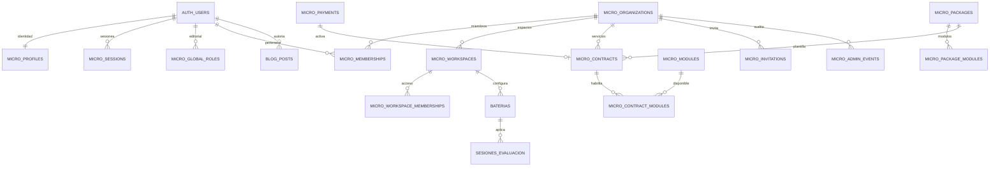

# Sprint 01 — Ecosystem Core

## Estado y decisiones

Prototipo en **`microhub-001`**, siguiendo el nombre elegido al inicio de la solicitud. Este nombre sustituye el `feature/ecosystem-core` del bloque de referencia. `main` se conserva en `e7a7b56`. El primer commit de la rama guarda el trabajo previamente revisado de MicroHub y del blog; los siguientes separan las fases del sprint.

Implementación local funcional. No se ejecutaron migraciones en Supabase de producción, no se enviaron correos reales y no se publicó un despliegue en Vercel. La promoción y las migraciones reales requieren autorización después de probar un Supabase independiente.

### Diagnóstico del repositorio

- Next 16.2.6, React 19, TypeScript estricto, Tailwind 4; Vercel usa `next build`. Se conserva también la compilación Vinext del proyecto.
- Supabase Auth mediante REST y un proveedor de sesión compartido. Se conserva ese cliente; no se instala un SDK paralelo.
- Microtalento ya tenía siete bancos, baterías, aplicaciones anónimas, calificación de servidor, resultados y PDF. Su ámbito era únicamente el reclutador propietario y las API consultaban con llave privilegiada.
- El blog ya tenía gestor, imágenes privadas, lectura pública y un propietario root. Se amplía ese gestor en vez de reemplazarlo.
- Se revisaron en modo lectura `ScoutWeb/components/blog-browser.tsx`, `blog-post-card.tsx` y `admin/blog-manager.tsx` como referencia Escultista: búsqueda, categorías, fichas y ciclo crear/editar/publicar. Se reutiliza la adaptación editorial que ya estaba en MicroWeb; sus colores, fuentes y layout prevalecen.

### Arquitectura adoptada

Un monolito modular con una sola identidad y una sola base. MicroID autentica; roles, membresías y contratos son conceptos separados. Los roles editoriales no dependen de pagar MicroHub. Los candidatos siguen sin necesitar cuenta.

Las API profesionales envían la llave pública más el **JWT del usuario**, para aplicar RLS en base de datos. Los comandos administrativos son funciones transaccionales con autorización explícita, `search_path` vacío y auditoría. La llave secreta se reserva al transporte del candidato anónimo y a archivos privados, después de comprobar código/secreto o permisos RLS.

La autorización de módulos evalúa en cada solicitud: identidad activa, sesión no revocada, institución activa, membresía profesional/administrativa, espacio autorizado, módulo activo y contrato dentro de vigencia. Suspender o expirar no depende de un cron. La interfaz actualiza el contexto cada 60 segundos; el servidor aplica la revocación inmediatamente.

Los contratos guardan una fotografía de los módulos del paquete. Editar un paquete cambia futuras contrataciones, conservando lo contratado anteriormente. La configuración se separa en catálogo, paquete y contrato para futuras extensiones. No hay pasarela de pagos.

## Modelo de datos



`microhub_admins` conserva la designación del propietario. `micro_global_roles` permite `author` y `editor` simultáneamente. Una membresía tiene un rol por institución (`member`, `professional`, `institution_admin`) y puede coexistir con otras instituciones y permisos editoriales. El usuario registrado existe implícitamente al crear MicroID.

Las aplicaciones tienen claves foráneas compuestas que impiden mezclar batería, propietario, organización y espacio. El ámbito del histórico es inmutable. La auditoría registra operaciones administrativas y estados editoriales; no incorpora respuestas psicológicas ni cuerpos de artículos.

### Permisos

| Perfil | Acceso |
|---|---|
| Visitante | Publicaciones visibles y formulario con enlace privado de candidato |
| Usuario registrado | MicroID, perfil y sesiones; sin herramientas pagadas automáticamente |
| Autor | Sus borradores, previsualización, imágenes y envío a revisión |
| Editor | Archivo editorial, publicación, retirada y destacados |
| Profesional | Módulos contratados en sus espacios; Microtalento conserva el filtro por propietario |
| Administrador institucional | Usuarios, invitaciones y espacios de su institución; no controla pagos, catálogo ni roles globales |
| Superadministrador | Metadatos administrativos, instituciones, contratos, pagos, catálogo y roles editoriales; sin acceso clínico automático |

Nadie puede editar directamente sus roles o habilitaciones comerciales. Los comandos impiden cambiar la membresía, el rol editorial o la habilitación propia. Para otorgar un ámbito profesional al propietario se requiere una membresía explícita asignada por otro administrador institucional, o su continuidad histórica; ser root no basta.

## Fases y archivos principales

1. **MicroID:** `lib/micro-id-server.ts`, `/api/micro-id`, proveedor Auth existente, `micro-id-account.tsx`, `micro-id-recovery.tsx`; registro, recuperación, perfil y revocación de sesiones. La revocación global también invalida sesiones antiguas que no habían registrado actividad local. Se consulta el identificador y la fecha precisa de `auth.sessions`, siguiendo el control de cierre recomendado por [Supabase Auth](https://supabase.com/docs/guides/auth/sessions#how-to-ensure-an-access-token-jwt-cannot-be-used-after-a-user-signs-out); no se modifica el esquema de Auth. Los enlaces de recuperación se consumen también al abrirse en la misma pestaña.
2. **Instituciones y permisos:** `lib/ecosystem*.ts`, `ecosystem-provider.tsx`, migración `002`; contexto central y selector por usuario.
3. **Motor modular:** `module-catalog.tsx`, `/microhub/modulos/[id]`; catálogo persistente. Microtalento es operativo; SWAP y Psicometría están en `coming_soon`. Los prototipos locales antiguos de expediente/bitácora quedan tras el permiso de SWAP y no se presentan como servicio clínico instalado.
4. **MicroAdmin:** `micro-admin.tsx`, `/api/ecosystem/admin`, migración `003`; paquetes, pagos externos idempotentes por referencia, vigencias, suspensiones, invitaciones y bitácora. Añadir un módulo de catálogo usa una ruta genérica; implementar una herramienta nueva sigue requiriendo su lógica específica.
5. **Microtalento:** API `recruiter`, `sesion`, `pdf`, `super-battery-01.tsx`, migración `004`. No se modifica el motor de calificación ni los reactivos.
6. **Publicaciones:** gestor existente ampliado, `lib/blog-repository.ts`, `publication-cards.tsx`, `/publicaciones`, `/publicaciones/gestor`, `/publicaciones/autores/[id]`; migración `005`.
7. **Verificación:** pruebas `ecosystem-*.test.mjs`, adaptador local `ecosystem-gateway.mjs`, recorrido `scripts/verify-ecosystem-e2e.mjs`, preflight y preparación del preview.

### Continuidad de Microtalento

La migración crea una institución personal y un espacio privado para cada reclutador con baterías existentes. Añade un contrato `legacy` de continuidad, sin inventar un pago. Esto conserva el acceso adquirido en el producto anterior; el propietario puede revisar y suspender esa continuidad desde MicroAdmin.

Se mantienen IDs, códigos, respuestas, resultados y rutas de PDF. Los enlaces históricos sin secreto adicional continúan funcionando. Las nuevas aplicaciones reciben **un código IB y un secreto aleatorio por batería completa**, nunca un enlace por test. La secuencia PostgreSQL asigna los códigos de manera atómica, incluso después de IB-9999. Crear una nueva liga no reescribe la configuración histórica de la batería.

El candidato completa el formulario, responde secciones consecutivas y descansa entre pruebas. La cookie HttpOnly permite reanudar en el mismo navegador y rechaza otro navegador que intente tomar la sesión iniciada. Los PDF nuevos usan una ruta que incluye su hash para que dos envíos concurrentes no se sobrescriban. Descargar un PDF verifica propietario/espacio y lee el archivo guardado; un histórico sin archivo se puede reconstruir sin modificar el registro.

Suspender la institución, el espacio o el servicio también impide continuar aplicaciones abiertas hasta reactivar. El borrador local se conserva para reintentar. Los antiguos códigos sin secreto siguen siendo una compatibilidad heredada; no se emiten nuevos enlaces con ese formato menos protegido.

## Administración

1. Crear y confirmar una cuenta en `/registro`. Iniciar sesión en `/ingresar`; la sesión se comparte al navegar por MicroHub, MicroID y el gestor editorial.
2. Designar el propietario con `supabase/setup/02_asignar_super_root.sql`, sustituyendo solo `TU_CORREO_AQUI`. El usuario debe existir. No se usan metadatos de registro para dar privilegios.
3. Abrir `/microhub/admin`. En **Instituciones**, crear la institución; se crea su espacio Principal. Se pueden añadir más espacios.
4. En **Usuarios**, asignar un usuario registrado al espacio o invitarlo desde **Invitaciones**. El rol Profesional permite usar servicios habilitados. La asignación de espacios es aditiva; suspender la membresía revoca todos los accesos de esa institución.
5. En **Catálogo**, crear un paquete con módulos. SWAP/Psicometría permanecen pendientes de implementar aunque se incluyan en un paquete. No activarlos comercialmente como herramientas terminadas.
6. En **Servicios**, registrar el pago externo, referencia, moneda, paquete/módulos y fechas. El pago y el contrato se guardan en una transacción. Reintentar la misma referencia e importe no duplica el cobro ni el contrato.
7. Revisar vigencias y suspender/reactivar desde Servicios. Habilitación individual permite cambiar módulos de un contrato sin modificar el catálogo base.
8. Dar roles Autor/Editor en Usuarios, independientemente de MicroHub. El gestor está en `/publicaciones/gestor`; un autor guarda y envía a revisión, un editor publica. La lectura pública tiene categorías Psicología, Tecnología y Comunalidad, búsqueda, destacados y perfiles sin correo ni datos de sesión.
9. En `/micro-id`, editar nombre/presentación pública, cambiar contraseña mediante recuperación y cerrar sesiones.

Las invitaciones guardan solo el hash de un token aleatorio, duran siete días, requieren el mismo correo confirmado y se aceptan una vez. MicroAdmin muestra el enlace para copiarlo. El envío opcional utiliza Supabase Auth y depende del SMTP y de las URLs permitidas; un fallo de correo conserva el enlace manual. Revocar una membresía/rol invalida sus invitaciones pendientes correspondientes.

## Migraciones y preview

### Preparación local (no despliega)

En la carpeta del Escritorio y en `microhub-001`:

```sh
npm run preview:prepare
```

Genera `.ecosystem-preview/ecosystem-core.sql`, un manifiesto SHA-256 y la plantilla de variables. La carpeta está ignorada por Git. **El nombre/ruta del archivo no es SQL**: en SQL Editor se pega el contenido completo. El generador no usa llaves ni se conecta a Supabase/Vercel.

### Base de pruebas

Crear un proyecto Supabase independiente con usuarios y datos ficticios. Para una base vacía, instalar todas las migraciones del repositorio en orden mediante Supabase CLI o SQL Editor; no reaplicar los antiguos archivos de 20261027 sobre tablas instaladas. Para una copia con el esquema anterior de MicroWeb instalado:

1. Ejecutar `supabase/setup/03_ecosystem_preflight.sql`. Los contadores de propietarios inconsistentes y de artículos con rutas reservadas deben ser cero; deben existir la columna de reanudación y los buckets privados.
2. Guardar un respaldo y verificar la restauración en otra base de pruebas.
3. Aplicar en orden las cinco migraciones `202611250001` a `202611250005`, o el bundle generado. Son aditivas y su reaplicación está probada. Cada archivo tiene su transacción; si uno falla, corregir ese paso antes de continuar. La migración editorial se detiene ante artículos antiguos con slug `gestor` o `autores`, para revisar sus enlaces sin renombrarlos automáticamente.
4. Crear cuentas ficticias y asignar el root de **pruebas** con el SQL de setup. No importar usuarios/pacientes reales al prototipo.
5. Verificar recuentos y conservación de IDs/resultados/PDF del conjunto de prueba.

### Vercel Preview

Usar un proyecto Vercel aislado para el prototipo o una configuración de rama con variables **exclusivas de Preview**. Revisar antes las variables de “All Environments”: no debe heredarse el Supabase de producción. No cambiar el proyecto/dominio productivo ni la rama de producción.

La plantilla `config/ecosystem-preview.env.example` enumera las variables exactas. `SUPABASE_SECRET_KEY` (o la alternativa legacy `SUPABASE_SERVICE_ROLE_KEY`) permanece exclusivamente en servidor. No usar prefijo `NEXT_PUBLIC_` para una llave secreta. URL, llave pública y llave secreta deben pertenecer al mismo proyecto de pruebas. No se requiere un segundo servicio de identidad ni una base por módulo.

En Supabase Auth, habilitar registro, confirmación de correo y SMTP; permitir las URLs del preview `/auth/confirm` y `/micro-id/recuperar`. El correo de invitación vuelve a `/auth/confirm?next=/micro-id/invitacion…`. Usar un hostname estable para el ambiente de pruebas. Vercel conserva `next build` como comando y Node >=22.13.0.

Después de la aprobación del propietario: subir esta rama, desplegar **Preview**, probar con dos instituciones ficticias y verificar correos reales de prueba. No promover a Production hasta validar migraciones, Storage privado, aislamiento, Microtalento y respaldo restaurable.

## Pruebas reproducibles

```sh
npm ci
npm run lint
npx tsc --noEmit
npm test
npx next build
```

`npm test` compila Vinext y ejecuta las pruebas previas y nuevas. PGlite es una dependencia **solo de desarrollo**: ejecuta PostgreSQL, migraciones, triggers, roles y RLS reales en memoria. Las pruebas cubren autoasignación, ámbitos institucionales, suspensión, vigencia, pagos idempotentes, invitaciones, autor/editor, sesiones, conservación de Microtalento, idempotencia de migraciones y restauración de un respaldo ficticio.

Para el recorrido aislado en Next, compilar **sin llaves reales**:

```sh
NEXT_PUBLIC_SUPABASE_URL=http://127.0.0.1:4881 \
NEXT_PUBLIC_SUPABASE_PUBLISHABLE_KEY=qa-public-key \
SUPABASE_SECRET_KEY=qa-service-key-never-production npx next build
```

Después ejecutar `npm run test:ecosystem:e2e` con `E2E_PLAYWRIGHT_PATH` apuntando a una instalación local de Playwright y sus navegadores instalados. `E2E_CHROME` permite indicar el ejecutable de Chrome. Los puertos 4881/4882 son locales; no apuntan a producción. La prueba inicia/cierra gateway y Next, crea datos ficticios y guarda capturas, PDF e informe en `/private/tmp/ecosystem-core-e2e` (o `E2E_OUTPUT`). Playwright no se añade al bundle de la aplicación.

El gateway sustituye transporte Auth/Storage; las reglas comerciales, triggers y RLS son las migraciones reales. Esta prueba no certifica configuración SMTP, latencia, políticas propias de una base remota ni hardware iPhone/Android real. Chrome y WebKit a 390 px son emulación de navegador.

## Copias, reversión y límites

- Antes de autorizar producción: respaldar esquema, datos y roles con el mecanismo de backup de Supabase o exportación administrada; exportar también los archivos de **ambos buckets**. Un respaldo de PostgreSQL no incluye los objetos binarios de Storage. Guardar cifrado, fuera del repositorio, y comprobar hashes y restauración en un ambiente independiente. Verificar la disponibilidad del plan/PITR del proyecto; este sprint no contrata ni configura una política de retención en la nube.
- La prueba de restauración local comprueba el mecanismo de PGlite, no constituye un respaldo de Supabase de producción.
- Para revertir solo el prototipo, detener su despliegue y conservar sus tablas. No eliminar columnas ni datos históricos para ocultar la interfaz.
- Si una migración falla, su transacción se revierte; no continuar a ciegas. Mantener mantenimiento durante una reversión de aplicación: una versión antigua que use service role podría eludir los controles nuevos, y sus INSERT no incluyen el ámbito obligatorio.
- La reversión completa exige restaurar el respaldo **en una base independiente**, validar histórico/PDF y cambiar la conexión del despliegue autorizado. No ejecutar `DROP ... CASCADE` en producción como rollback.
- No se automatizan decisiones de contratación ni se afirma validación psicométrica. La calificación y los reactivos existentes se conservan.
- La sesión sigue el patrón localStorage existente. Supabase valida tokens y RLS revisa permisos; una futura migración a cookies SSR/HttpOnly debe planearse aparte para no duplicar autenticación.
- El panel limita a 500 usuarios y 100 eventos recientes por consulta. Paginación administrativa, alertas operativas y limpieza de archivos huérfanos de envíos fallidos son mejoras posteriores.
- SWAP completo, Psicometría avanzada, pagos en línea y aplicaciones nativas quedan fuera del sprint.

## Registro de cambios

- Se guardó el baseline previamente aceptado y se creó la rama del prototipo sin modificar main.
- Se añadieron MicroID, instituciones, permisos independientes, módulos y MicroAdmin.
- Se integraron pagos externos, contratos, paquetes, invitaciones y auditoría sin privilegios clínicos implícitos.
- Se acotó Microtalento por institución/espacio, conservando propiedad, histórico y candidatos anónimos.
- Se añadieron autores, revisión editorial, destacados, categorías, buscador y perfiles públicos.
- Se incorporaron pruebas PostgreSQL/RLS, recorrido de 204 respuestas/PDF, revisión móvil y preparación local del preview.

## Resultado de la verificación local (25 de noviembre de 2026)

- Lint y TypeScript sin errores; build Vinext y build Next de producción correctos.
- 29 pruebas automatizadas aprobadas, incluidas 9 de PostgreSQL/RLS, migración y respaldo.
- Chrome: login, registro, perfil, navegación con una sesión, recuperación simulada y batería de siete pruebas/204 respuestas con seis descansos. PDF almacenado y descargado con SHA-256 coincidente.
- WebKit: login compartido, MicroAdmin y creación de una institución desde el formulario a 390 px. Sin desbordamiento horizontal ni excepciones de ejecución en los recorridos verificados.
- API: dos instituciones aisladas, root sin acceso clínico implícito, suspensión/reactivación, rol editorial sin contrato, revisión/publicación/búsqueda/perfil e invitación de un solo uso.
- Correos y Storage se simulan en el adaptador local; el ambiente remoto y dispositivos físicos requieren la validación de preview indicada arriba.
